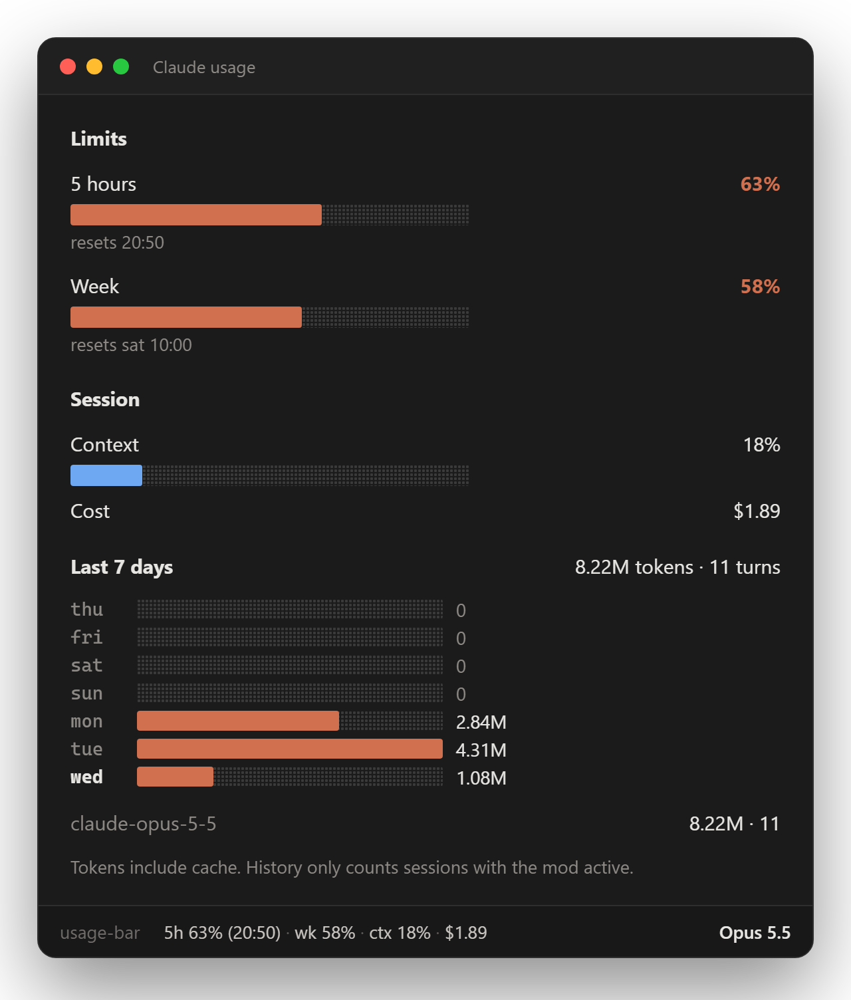
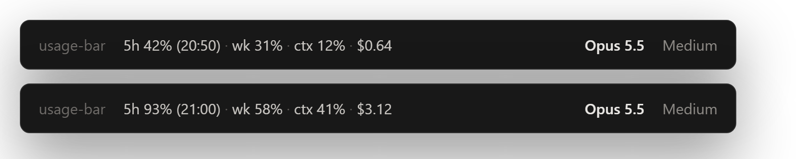

# usage-bar

[](https://github.com/araujo-eduardo/claude-usage-bar/releases/latest)
[](LICENSE)
[](https://claude.com/blog/claude-code-mods)
[](#configure)

**English** · [Português (Brasil)](README.pt-BR.md)

**A Claude Code mod that keeps your Claude usage in view**: the 5-hour and weekly rate limits, context fill and session cost in the status line, plus a pane with a 7-day token history. Every number comes from Claude Code's own session events, and nothing leaves your machine.

<p align="center">
  
</p>

<p align="center">
  <a href="#install">Install</a> · <a href="#what-you-see">What you see</a> · <a href="#what-it-can-reach">What it can reach</a> · <a href="#configure">Configure</a> · <a href="#troubleshooting">Troubleshooting</a> · <a href="CHANGELOG.md">What's new</a>
</p>

## Install

Inside Claude Code:

```
/plugin marketplace add araujo-eduardo/claude-usage-bar
/plugin install usage-bar@claude-usage-bar
/reload-plugins
/usage-bar
```

<details>
<summary><strong>From the terminal, the desktop app, or a clone</strong></summary>

```sh
claude plugin marketplace add araujo-eduardo/claude-usage-bar
claude plugin install usage-bar@claude-usage-bar
```

In the desktop app, where `/plugin` does not run: click **+** next to the prompt box, then **Plugins**, **Add marketplace** with `araujo-eduardo/claude-usage-bar`, then **Add plugin**.

Or load it straight from a clone, for one session:

```sh
git clone https://github.com/araujo-eduardo/claude-usage-bar
claude --plugin-dir ./claude-usage-bar
```

</details>

Mods are an early-access Claude Code feature and their API can change between releases. If something breaks, see [Troubleshooting](#troubleshooting).

## What you see

### Status line

Always on, updated whenever a figure moves (no polling):

<p align="center">
  
</p>

```
5h 63% (20:50) · wk 58% · ctx 18% · $1.89
```

| Part | Meaning |
| --- | --- |
| `5h 63% (20:50)` | share of the 5-hour window used, and when it resets |
| `wk 58%` | share of the weekly window used |
| `ctx 18%` | context window fill |
| `$1.89` | session cost so far, as `/cost` totals it |

### Pane

`/usage-bar` opens it beside the transcript.

| Section | Shows | From |
| --- | --- | --- |
| **Limits** | 5-hour and weekly bars with reset times; brand color below 70%, yellow from 70%, red from 90% | `session.measure`, `$.session.usage()` |
| **Session** | context fill and cost | the same |
| **Last 7 days** | one bar per day, total tokens and turns, and a per-model breakdown | `turn.complete` usage, kept in the plugin's store |

A **toast** fires once per 5-hour window when usage passes 90%.

## What it can reach

usage-bar only watches. Every hook passes its event on unchanged: it never denies, rewrites or delays a tool call, a prompt or a turn.

| It sees | Through |
| --- | --- |
| rate-limit windows, context fill and cost | `session.measure`, `$.session.usage()` |
| each turn's token usage and model id (not its text) | `turn.complete` |
| Claude Code's `language` setting and `LC_ALL` / `LANG`, only when `language` is `auto` | `$.settings.read`, `$.env.get` |

What it keeps: a daily tally of tokens and turns per model, for 30 days, in the plugin's own store. It makes **no** network requests, runs no processes, reads and writes no files, and calls no model. `claude plugin validate .` prints exactly what it hooks and calls.

## Configure

In `/config`, or under `pluginConfigs["usage-bar@claude-usage-bar"].options` in your user `settings.json` (`usage-bar` or `usage-bar@inline` with `--plugin-dir`).

| Option | Default | Meaning |
| --- | --- | --- |
| `language` | `auto` | `en`, `pt-BR`, or `auto`: Claude Code's `language` setting, then `LC_ALL` / `LANG`, then the system locale, else English |

```json
"pluginConfigs": {
  "usage-bar@claude-usage-bar": { "options": { "language": "pt-BR" } }
}
```

## Notes and limits

- **Limits need a subscription.** The 5-hour and weekly windows come from the API's rate-limit readings, so they only exist on a Claude plan (Pro/Max) and show `—` until the first response of the session. On an API key only context and cost show.
- **Tokens include cache** reads and writes, so the totals look large.
- **History starts at install** and only counts sessions where the mod is active.
- **Concurrent sessions** share the store; the last write wins, so two sessions at once may each drop the odd turn.

## Troubleshooting

**`/usage-bar` does nothing or is unknown.** Run `/reload-plugins`, or start a new session. Note the command is `/usage-bar`; `claude-usage-bar` is only the marketplace name.

**The status line shows `limits —`.** No API response has reported a rate limit yet in this session, or you are on an API key.

**The language is wrong.** Set `language` explicitly; `auto` falls back to English when nothing hints otherwise. Check the key in `pluginConfigs` matches how the plugin was loaded.

**It loads twice.** Remove any copy under `~/.claude/dev-mods/` once installed from the marketplace.

Still stuck? Look in the transcript for a dim line starting `usage-bar:` and [open an issue](https://github.com/araujo-eduardo/claude-usage-bar/issues) with it.

## How it works

| File | Holds |
| --- | --- |
| [`hooks/register.tsx`](hooks/register.tsx) | the hooks, pure formatters, and the pane |
| [`hooks/i18n.ts`](hooks/i18n.ts) | strings for `en` and `pt-BR`, and the `auto` language resolver |
| [`types/index.d.ts`](types/index.d.ts) | the state contract |
| [`tests/`](tests) | status line, toast, history, pane drawing on two surfaces, and language selection |
| [`docs/media/src/`](docs/media/src) | the HTML the README images are rendered from |

## Related projects

- [claude-flightdeck](https://github.com/scasella/claude-flightdeck): a live agent dashboard pane. Use both: that's the agents, this is the quota.
- [ccusage](https://github.com/ccusage/ccusage): cost reports from your session logs.
- [awesome-claude-code-mods](https://github.com/karanb192/awesome-claude-code-mods): the index of Claude Code mods.

## Develop

```sh
claude --plugin-dir .            # load it; edits hot-reload
claude plugin validate .
claude plugin test .
```

Changes are listed in [CHANGELOG.md](CHANGELOG.md).

## License

[MIT](LICENSE)
