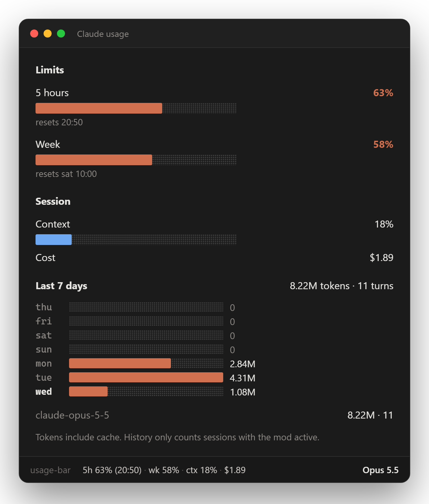
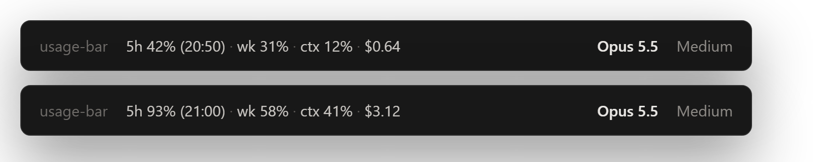

# usage-bar

[](https://github.com/araujo-eduardo/claude-usage-bar/releases/latest)
[](LICENSE)
[](https://claude.com/blog/claude-code-mods)
[](#configuração)

[English](README.md) · **Português (Brasil)**

**Um mod para o Claude Code que mantém seu uso do Claude à vista**: os limites de 5 horas e semanal, a ocupação do contexto e o custo da sessão na status line, mais um painel com o histórico de tokens dos últimos 7 dias. Todos os números vêm dos eventos de sessão do próprio Claude Code, e nada sai da sua máquina.

<p align="center">
  
</p>

<p align="center">
  <a href="#instalação">Instalação</a> · <a href="#o-que-aparece">O que aparece</a> · <a href="#o-que-ele-acessa">O que ele acessa</a> · <a href="#configuração">Configuração</a> · <a href="#solução-de-problemas">Solução de problemas</a> · <a href="CHANGELOG.md">Novidades</a>
</p>

> As imagens mostram a interface em inglês. Com `language: pt-BR` os textos aparecem em português.

## Instalação

Dentro do Claude Code:

```
/plugin marketplace add araujo-eduardo/claude-usage-bar
/plugin install usage-bar@claude-usage-bar
/reload-plugins
/usage-bar
```

<details>
<summary><strong>Pelo terminal, pelo app desktop ou a partir de um clone</strong></summary>

```sh
claude plugin marketplace add araujo-eduardo/claude-usage-bar
claude plugin install usage-bar@claude-usage-bar
```

No app desktop, onde `/plugin` não funciona: clique em **+** ao lado da caixa do prompt, depois em **Plugins**, **Add marketplace** com `araujo-eduardo/claude-usage-bar` e então **Add plugin**.

Ou carregue direto de um clone, para uma sessão:

```sh
git clone https://github.com/araujo-eduardo/claude-usage-bar
claude --plugin-dir ./claude-usage-bar
```

</details>

Mods são um recurso em acesso antecipado do Claude Code, e a API pode mudar entre versões. Se algo quebrar, veja [Solução de problemas](#solução-de-problemas).

## O que aparece

### Status line

Sempre visível, atualizada quando algum número muda (sem polling):

<p align="center">
  
</p>

```
5h 63% (20:50) · sem 58% · ctx 18% · $1.89
```

| Parte | Significado |
| --- | --- |
| `5h 63% (20:50)` | quanto da janela de 5 horas foi usado, e quando reinicia |
| `sem 58%` | quanto da janela semanal foi usado |
| `ctx 18%` | ocupação da janela de contexto |
| `$1.89` | custo da sessão até agora, como o `/cost` soma |

### Painel

O `/usage-bar` abre o painel ao lado do transcript.

| Seção | Mostra | Origem |
| --- | --- | --- |
| **Limites** | barras de 5 horas e semanal com horário de reinício; cor do Claude abaixo de 70%, amarelo a partir de 70%, vermelho a partir de 90% | `session.measure`, `$.session.usage()` |
| **Sessão** | ocupação do contexto e custo | a mesma |
| **Últimos 7 dias** | uma barra por dia, total de tokens e turnos, e divisão por modelo | uso do `turn.complete`, guardado no store do plugin |

Um **toast** aparece uma vez por janela de 5 horas quando o uso passa de 90%.

## O que ele acessa

O usage-bar só observa. Todo hook repassa o evento sem mudança: ele nunca nega, reescreve ou atrasa uma chamada de ferramenta, um prompt ou um turno.

| Ele vê | Por meio de |
| --- | --- |
| janelas de rate limit, ocupação do contexto e custo | `session.measure`, `$.session.usage()` |
| uso de tokens e id do modelo de cada turno (não o texto) | `turn.complete` |
| a configuração `language` do Claude Code e `LC_ALL` / `LANG`, só quando `language` é `auto` | `$.settings.read`, `$.env.get` |

O que ele guarda: um total diário de tokens e turnos por modelo, por 30 dias, no store do próprio plugin. Ele **não** faz requisições de rede, não roda processos, não lê nem grava arquivos e não chama modelo. O `claude plugin validate .` lista exatamente o que ele usa.

## Configuração

Em `/config`, ou em `pluginConfigs["usage-bar@claude-usage-bar"].options` no `settings.json` do usuário (`usage-bar` ou `usage-bar@inline` com `--plugin-dir`).

| Opção | Padrão | Significado |
| --- | --- | --- |
| `language` | `auto` | `en`, `pt-BR` ou `auto`: configuração `language` do Claude Code, depois `LC_ALL` / `LANG`, depois o locale do sistema, senão inglês |

```json
"pluginConfigs": {
  "usage-bar@claude-usage-bar": { "options": { "language": "pt-BR" } }
}
```

## Observações e limites

- **Limites exigem assinatura.** As janelas de 5 horas e semanal vêm das leituras de rate limit da API, então só existem em plano do Claude (Pro/Max) e aparecem como `—` até a primeira resposta da sessão. Com chave de API aparecem só contexto e custo.
- **Tokens incluem cache** (leitura e escrita), por isso os totais parecem altos.
- **O histórico começa na instalação** e só conta sessões com o mod ativo.
- **Sessões simultâneas** dividem o mesmo store; vale a última gravação, então duas sessões ao mesmo tempo podem perder um turno ou outro.

## Solução de problemas

**O `/usage-bar` não faz nada ou não existe.** Rode `/reload-plugins` ou abra uma sessão nova. O comando é `/usage-bar`; `claude-usage-bar` é só o nome do marketplace.

**A status line mostra `limites —`.** Nenhuma resposta da API informou rate limit ainda nesta sessão, ou você está usando chave de API.

**O idioma está errado.** Defina `language` explicitamente; o `auto` usa inglês quando nada indica outro idioma. Confira se a chave em `pluginConfigs` corresponde a como o plugin foi carregado.

**Ele carrega duas vezes.** Depois de instalar pelo marketplace, remova qualquer cópia em `~/.claude/dev-mods/`.

Ainda com problema? Procure no transcript uma linha apagada começando com `usage-bar:` e [abra uma issue](https://github.com/araujo-eduardo/claude-usage-bar/issues) com ela.

## Como funciona

| Arquivo | Contém |
| --- | --- |
| [`hooks/register.tsx`](hooks/register.tsx) | os hooks, formatadores puros e o painel |
| [`hooks/i18n.ts`](hooks/i18n.ts) | textos em `en` e `pt-BR`, e a detecção do idioma no modo `auto` |
| [`types/index.d.ts`](types/index.d.ts) | o contrato de estado |
| [`tests/`](tests) | status line, toast, histórico, desenho do painel em duas superfícies e seleção de idioma |
| [`docs/media/src/`](docs/media/src) | o HTML de onde as imagens do README são renderizadas |

## Projetos relacionados

- [claude-flightdeck](https://github.com/scasella/claude-flightdeck): painel ao vivo dos agentes. Use os dois: aquele mostra os agentes, este mostra a cota.
- [ccusage](https://github.com/ccusage/ccusage): relatórios de custo a partir dos logs de sessão.
- [awesome-claude-code-mods](https://github.com/karanb192/awesome-claude-code-mods): o índice de mods do Claude Code.

## Desenvolvimento

```sh
claude --plugin-dir .            # carrega; edições recarregam sozinhas
claude plugin validate .
claude plugin test .
```

As mudanças ficam no [CHANGELOG.md](CHANGELOG.md).

## Licença

[MIT](LICENSE)
